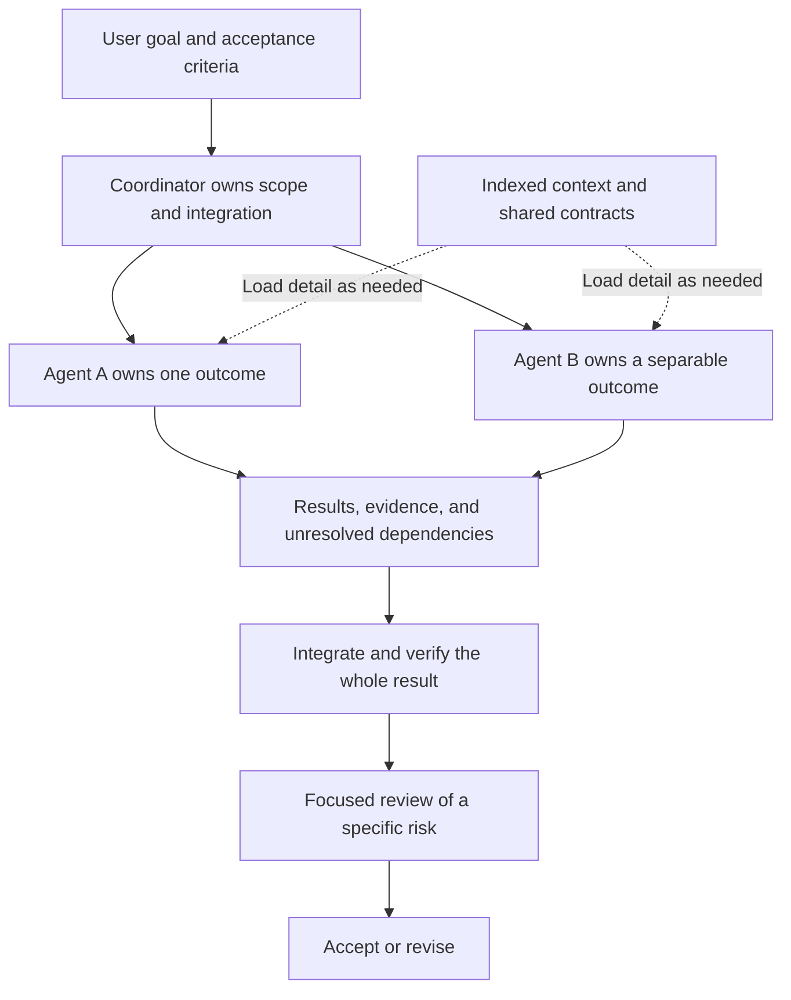

# Software engineering fundamentals for agentic coding

Series planning brief, 2026-10-10. Marshall's argument: software-engineering fundamentals become more important when agents do the coding. Teach the agent operating model first, then connect individual engineering principles to concrete improvements in how agents understand, change, and verify software. Each lesson becomes one short post and one video. Later, assemble them into the course described in [D6](DECISIONS.md#d6-eventual-course).

The audience proposed here is working developers who already use coding agents and want more reliable results. This brief uses an internal planning register. Episode order, examples, and exercises are suggestions for discussion. [DECISIONS.md](DECISIONS.md) records Marshall's actual selections.

## The foundational model

**Give each agent one coherent outcome, enough context to achieve it, and a clear way to prove it is done.** That is the proposed operating rule for the series. A coordinator understands the overall objective and dependencies. Workers load the detail needed for their assignments and return useful results with evidence. The coordinator owns integration and the check that the combined result satisfies the original objective. This applies the context-management and delegation ideas in [C03–C05](research/sources.md#c03-progressive-disclosure-and-sufficient-context) using the proposed ownership model in [A02](research/sources.md#a02-focused-ownership-with-explicit-handoffs).

This is a teaching model, not a fixed roster of agents. Keep tightly coupled work together. Parallelize work whose outputs can be reconciled. A researcher, implementer, or reviewer is a possible assignment, not a mandatory agent for every task. The evidence supports selective delegation and also documents coordination and token costs ([C05](research/sources.md#c05-multi-agent-gains-depend-on-task-structure-and-cost)).

The proposed assignment contract contains the desired outcome, relevant shared constraints, owned scope, an initial context packet, pointers to deeper material, acceptance criteria, and the expected return format. A useful return contains the result or artifact, evidence, assumptions, unresolved dependencies, and locations for further detail. Any constraint that can invalidate the result belongs in the contract even when implementation detail stays behind a reference.

### Progressive disclosure

Teach three levels: a small map of what exists and when to consult it, the selected task's instructions and contracts, then the source, examples, or tool results needed for the next decision. Important shared constraints arrive up front. Detailed investigation expands only as needed. The agent must be able to discover missing context and revisit its scope when a dependency appears. This is the practical application of [C03](research/sources.md#c03-progressive-disclosure-and-sufficient-context) and the skill-loading example in [C06](research/sources.md#c06-skills-offer-a-concrete-disclosure-mechanism).

### The budget

Marshall's targets are **under 150,000 total tokens per agent task where practical, with a ceiling below 250,000** ([D3](DECISIONS.md#d3-token-targets-and-accounting-scope)). These count cumulative work across calls. Active context occupancy is a separate measurement ([C07](research/sources.md#c07-capacity-occupancy-and-cumulative-usage-differ)).

For demonstrations, define the runtime's input, output, reasoning, and cached-token accounting explicitly so categories are not double-counted. Preserve a logical task's identity across resumptions. Report each agent's consumption, coordinator consumption, combined run consumption, elapsed time, and acceptance results. Several workers can each meet their budget while the combined cost rises.

The proposed response to an approaching ceiling is to inspect scope, dependencies, repeated discovery, and failed attempts, then change the work plan. Keep the acceptance criteria intact. The targets are a design constraint to investigate, not evidence that every task should require that many tokens or that crossing the number causes failure ([A03](research/sources.md#a03-the-proposed-150000--250000-token-budget)).

## Proposed opening sequence

Alternate agent mechanics with the books that help explain them. Each row is one self-contained lesson. The agent applications are proposals, with research links identifying the underlying concepts and their evidence limits.

| Order | Lesson | Source | Concrete teaching move |
|---|---|---|---|
| 1 | Give an agent a problem it can finish | [Focused-agent model](research/sources.md#a02-focused-ownership-with-explicit-handoffs) | Turn an open-ended request into an outcome, context map, budget, and acceptance check. Show who owns integration. |
| 2 | Make context discoverable | [Progressive disclosure](research/sources.md#c03-progressive-disclosure-and-sufficient-context) | Show an index leading to a contract, then to the relevant implementation. |
| 3 | Deep modules reduce what callers must understand | [Ousterhout, A Philosophy of Software Design](research/book-skill-inventory.md#b01-ousterhout-and-deep-modules) | Compare two interfaces to the same capability and the knowledge each asks of an agent using it. |
| 4 | Package a skill behind a useful interface | [Skills and disclosure](research/sources.md#c06-skills-offer-a-concrete-disclosure-mechanism) | Show discovery metadata, task instructions, and supporting resources. Distinguish a reusable skill from the agent executing it. |
| 5 | Divide work along independent changes | [Hunt and Thomas, The Pragmatic Programmer](research/book-skill-inventory.md#b02-hunt-and-thomas-and-orthogonality) | Compare a split by filenames with a split by responsibilities and dependencies. Full book treatment still needs verification. |
| 6 | Give the agent a feedback loop | [Beck, Test Driven Development by Example](research/book-skill-inventory.md#b03-beck-and-incremental-tdd) | Demonstrate one behavior through a failing test, implementation, and a passing check. |
| 7 | Find a seam before changing the system | [Feathers, Working Effectively with Legacy Code](research/book-skill-inventory.md#b04-feathers-and-seams) | Substitute one troublesome dependency to make the relevant behavior testable. |
| 8 | Separate structural and behavioral changes | [Beck, Tidy First](research/book-skill-inventory.md#b05-beck-and-separating-kinds-of-change) | Make a useful preparation independently reviewable, then implement the feature. |
| 9 | Give adversarial review a question to investigate | [Hendrickson, Explore It](research/book-skill-inventory.md#b06-hendrickson-and-exploratory-charters) | Ask a reviewer to investigate one risk and supply a reproducible counterexample. Keep access to requirements and context. |
| 10 | Diagnose before patching | [Butcher, Debug It](research/book-skill-inventory.md#b07-butcher-and-experimental-debugging) | Show an observation, competing explanations, and an experiment that distinguishes them. |

Later candidates from the same skill inventory: Metz on dependency direction, Fowler on named refactorings, Evans on shared domain language, and Majors, Fong-Jones, and Miranda on observability. Their proposed applications and outstanding source work are in [B08–B11](research/book-skill-inventory.md#secondary-leads-for-later-lessons). Expand the series by useful principles rather than requiring one episode per book.

## The first book lesson

Proposed example: an agent needs to add a records export. In one design, its caller must assemble authentication, pagination, and transport handling scattered across helpers. In the other, a records interface owns those mechanics and documents its ordering, completeness, and failure behavior. Walk through what the caller must learn in each version before it can implement the export. This is a hypothetical example, not a reported project result.

Then change the assignment: the agent must alter pagination itself. Now it needs the implementation. This makes the disclosure rule concrete: the relevant detail depends on the task. Measure the paths inspected and actual run usage before claiming a token benefit. The proposed book-to-agent connection is documented in [A01](research/sources.md#a01-engineering-fundamentals-as-context-design).

The distinction to preserve is **focused responsibility with a complete contract**. Ousterhout's deep modules can hide substantial implementations. His argument does not prescribe tiny modules, and it should not be used to justify an agent for every tiny step ([C02](research/sources.md#c02-deep-modules-and-information-hiding)).

## One principle in two formats

Proposed lesson pattern:

1. Show a recognizable failure or a small before-example.
2. Explain one principle and credit its source.
3. Apply it to a specific agent task with an after-example.
4. Give the reader one action to try and a way to check the result.

The short post carries the example, reasoning, and citations. The video teaches the same complete idea with one visible artifact, such as an interface, task brief, test failure, or review finding. A starting production target is 400–700 words and roughly 60–120 seconds, adjustable after a pilot. These are suggested editorial lengths, not platform limits or an approved cadence. Detailed scripts can wait until Marshall chooses the first lesson's example.

TikTok, YouTube, and LinkedIn are the selected video destinations ([D5](DECISIONS.md#d5-post-and-video-unit)). Keep Yount Labs as the canonical written archive and give each platform a complete useful lesson, consistent with the [posting strategy](../../docs/2026-posting-strategy.md). This series adds video destinations without requiring changes to the site's general editorial cadence.

## Build toward the course

Keep a learning objective, source entry, before/after artifact, small exercise, and acceptance check with every lesson. The course can then group the material by what a learner can do: scope and supply context, design boundaries and handoffs, change behavior with feedback, and investigate results. Add the transitions and a worked end-to-end project when assembling it.

For the eventual course exercise, have the learner take one change through task decomposition, context loading, implementation, review, and integration. Assess correctness and evidence alongside token use. The exercise tests how the principles work together. It also provides a place to show when delegation creates more work than it saves.

Next editorial step: choose the opening lesson's concrete task and develop its post outline and video beats. The book shortlist and sequence above are ready for Marshall's revision.
