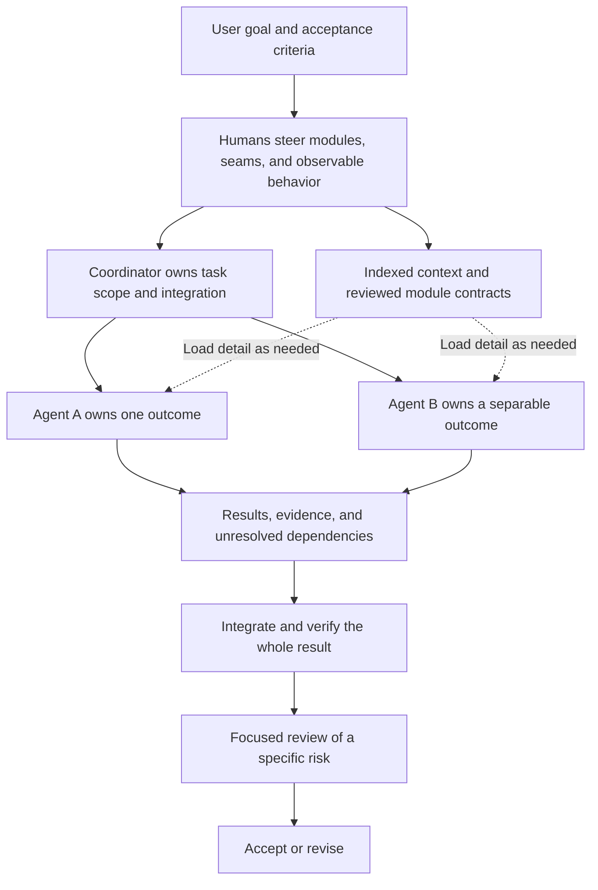

# Software engineering fundamentals for agentic coding

Series planning brief, 2026-10-10. Marshall's argument: software-engineering fundamentals become more important when agents do the coding. Teach the agent operating model first, then connect individual engineering principles to concrete improvements in how agents understand, change, and verify software. Each lesson becomes one short post and one video. Later, assemble them into the course described in [D6](DECISIONS.md#d6-eventual-course).

The audience proposed here is working developers who already use coding agents and want more reliable results. This brief uses an internal planning register. The seven-part sequence below follows Marshall's selected order. Individual lesson order, examples, and exercises remain suggestions for discussion. [DECISIONS.md](DECISIONS.md) records Marshall's actual selections.

The [113-lesson menu](lesson-ideas.md) groups the original 100 ideas and 13 additions under that sequence, retaining stable IDs for discussion. Its [source map](research/lesson-source-leads.md) identifies book and research leads for later development.

## The foundational model

**Give each agent one coherent outcome, enough context to achieve it, and a clear way to prove it is done.** That is the proposed operating rule for the series. A coordinator understands the overall objective and dependencies. Workers load the detail needed for their assignments and return useful results with evidence. The coordinator owns integration and the check that the combined result satisfies the original objective. This applies the context-management and delegation ideas in [C03–C05](research/sources.md#c03-progressive-disclosure-and-sufficient-context) using the proposed ownership model in [A02](research/sources.md#a02-focused-ownership-with-explicit-handoffs).

Marshall anticipates humans doing much of the steering at module boundaries: which modules exist, where they communicate, and what behavior is observable at those seams. Humans carefully review the public-interface tests as an executable contract. A calling agent should be able to load the interface file and its behavioral documentation to use the component, without opening the implementation. That compact description must reflect the contract expressed in the tests ([D8](DECISIONS.md#d8-human-steering-centers-on-modules-seams-and-contracts), [R06](research/replaceable-modules.md#r06-recursive-modules-and-human-reviewed-behavioral-contracts)).

This is a teaching model, not a fixed roster of agents. Keep tightly coupled work together. Parallelize work whose outputs can be reconciled. A researcher, implementer, or reviewer is a possible assignment, not a mandatory agent for every task. The evidence supports selective delegation and also documents coordination and token costs ([C05](research/sources.md#c05-multi-agent-gains-depend-on-task-structure-and-cost)).

The proposed assignment contract contains the desired outcome, relevant shared constraints, owned scope, an initial context packet, pointers to deeper material, acceptance criteria, and the expected return format. A useful return contains the result or artifact, evidence, assumptions, unresolved dependencies, and locations for further detail. Any constraint that can invalidate the result belongs in the contract even when implementation detail stays behind a reference. This delegation agreement is distinct from the module's behavioral contract, which persists across individual agent assignments.

### Progressive disclosure

Teach three levels: a small map of what exists and when to consult it, the selected task's instructions and contracts, then the source, examples, or tool results needed for the next decision. Important shared constraints arrive up front. Detailed investigation expands only as needed. The agent must be able to discover missing context and revisit its scope when a dependency appears. This is the practical application of [C03](research/sources.md#c03-progressive-disclosure-and-sufficient-context) and the skill-loading example in [C06](research/sources.md#c06-skills-offer-a-concrete-disclosure-mechanism).

### Named principles as compact guidance

Marshall's favorite Pocock idea connects the opening context model to the book lessons: a short reference such as *deep modules (John Ousterhout)* or *tracer bullets (The Pragmatic Programmer)* can cue an agent to apply a larger body of engineering knowledge. Pocock calls these **leading words**. His presentation and written explanation describe using recognizable concepts to convey direction compactly ([P12](research/matt-pocock.md#p12-leading-words-as-compact-guidance), [D15](DECISIONS.md#d15-named-principles-as-compact-guidance)).

Proposed teaching pattern: explain the principle, give a short phrase that invokes it, and show the behavior the reader should look for. For example, ask for a tracer bullet through one complete customer operation, then inspect whether the result actually connects the relevant parts of the system. For deep modules, inspect whether a caller can use the interface without learning the implementation. These examples apply the concepts documented in [P03 and P06](research/matt-pocock.md).

Combine the named principle with the task's constraints and acceptance criteria. Use progressive disclosure for project detail and unfamiliar or disputed meanings. The human still needs enough understanding to choose the concept and judge its application. Shorter guidance is a promising way to conserve input context. Any reduction in total tokens to finish the task remains a separate measurement ([P12](research/matt-pocock.md#p12-leading-words-as-compact-guidance)).

### The budget

Marshall's targets are **under 150,000 total tokens per agent task where practical, with a ceiling below 250,000** ([D3](DECISIONS.md#d3-token-targets-and-accounting-scope)). These count cumulative work across calls. Active context occupancy is a separate measurement ([C07](research/sources.md#c07-capacity-occupancy-and-cumulative-usage-differ)).

For demonstrations, define the runtime's input, output, reasoning, and cached-token accounting explicitly so categories are not double-counted. Preserve a logical task's identity across resumptions. Report each agent's consumption, coordinator consumption, combined run consumption, elapsed time, and acceptance results. Several workers can each meet their budget while the combined cost rises.

The proposed response to an approaching ceiling is to inspect scope, dependencies, repeated discovery, and failed attempts, then change the work plan. Keep the acceptance criteria intact. The targets are a design constraint to investigate, not evidence that every task should require that many tokens or that crossing the number causes failure ([A03](research/sources.md#a03-the-proposed-150000--250000-token-budget)).

## Selected series sequence

Marshall selected this progression in [D13](DECISIONS.md#d13-organize-the-series-in-seven-parts). Each part contains multiple short posts and videos. The lesson menu supplies candidates, with the exact selection and order inside each part still open.

| Part | Focus | Core material |
|---|---|---|
| 1 | Context efficient agent model | Focused agents, sufficient context, progressive disclosure, named principles as compact guidance, task budgets, coordination, and narrowly focused adversarial reviews. |
| 2 | Code architecture and design | Deep modules, human-reviewed seams and contracts, Unix utilities that do one thing well and compose, and domain language that unambiguously matches customer conversations. |
| 3 | Writing great code | TDD through red, green, refactor. Tidy first when the refactoring makes the implementation easier. Small changes and effective feedback. |
| 4 | Writing great tests | Public behavior, Metz's interface-testing guidance, trustworthy doubles, systematic cases, properties, and evidence that tests can detect faults. |
| 5 | Molding architecture using refactoring | Characterization, seams, moving responsibilities, changing abstractions, and replacing internals while preserving contracts. |
| 6 | Measuring our quality with static code analysis | Types, complexity, duplication, dependencies, lint rules, and security analysis. Interpret each result in terms of the property it checks. |
| 7 | Operations | Observability, resilience, circuit breakers, feature flags and other operational controls, then deployments and recovery. |

The [source map](research/lesson-source-leads.md) traces these topics to their research. [S01–S04](research/curriculum-additions.md) add the Unix, domain-language, static-analysis, and feature-flag sources. The examples remain proposed applications to agentic coding.

The proposed teaching distinction between parts 3–5 is the workflow for making a change, the quality of the tests supporting it, and the deliberate reshaping of architecture. Teach enough testing to make the first TDD cycle concrete. Return to assertions, boundaries, and test design in part 4, then use those tools to support architectural change in part 5.

Present deep modules and Unix composition together. Explore a component's coherent responsibility, the capability its interface offers, and the cost of composing it with other components. Keep Marshall's recursive composition model: a deep module may contain smaller internal domains, and each relevant boundary should remain workable for its callers and maintainers. The proposed comparison should expose both information leakage and excessive fragmentation rather than prescribe a universal module size ([D7](DECISIONS.md#d7-deep-modules-use-recursive-composition), [S01](research/curriculum-additions.md#s01-unix-composition)).

For domain-driven design, carry the customer's terms through the requirements, tests, and domain code. Resolve ambiguous meanings in conversation and make translations explicit at domain boundaries. Evans' reference supports shared language within a bounded context ([S02](research/curriculum-additions.md#s02-domain-language-shared-with-customers)).

Static analysis supplies evidence about selected properties. Pair the score or finding with the code it describes and the reason to change it. Keep coverage, mutation results, operational telemetry, and change history identified as their own kinds of evidence ([S03](research/curriculum-additions.md#s03-static-analysis-and-its-evidence-limits)).

## Contemporary agentic-coding influences

Marshall also named Dex Horthy and Matt Pocock as influences ([D14](DECISIONS.md#d14-add-dex-horthy-and-matt-pocock-as-contemporary-influences)). Their work provides current applications to compare with the books. The dedicated [Horthy research](research/dex-horthy.md) and [Pocock research](research/matt-pocock.md) record sources, dates, inspection limits, and candidate lesson mappings.

Pocock offers particularly direct material for progressive disclosure, deep modules composed of smaller internal parts, domain vocabulary, vertical slices, behavior tests, and reviews with separate briefs. His [current workflow artifacts](research/matt-pocock.md#p10-the-current-skills-repository-as-an-implementation-artifact) also show why the series should name the version being discussed: the repository's TDD instructions now place refactoring differently from his earlier red–green–refactor presentation. Preserve Marshall's selected teaching sequence while examining that choice.

Horthy's work supplies the context-engineering and workflow side of the comparison, including research, planning, intentional compaction, and human ownership of the resulting code. Read the early material alongside his later revisions. Treat performance anecdotes as reported experience and examine each operational recommendation against a concrete task.

The [further-author reading list](research/further-authors.md) now supplies source leads throughout the lesson menu at Marshall's request ([D17](DECISIONS.md#d17-weave-contemporary-authors-through-the-lessons)). Simon Willison, Birgitta Böckeler, Armin Ronacher, Giles Edwards-Alexander, Addy Osmani, Geoffrey Huntley, and Kent Beck's contemporary work join the book references. The [source map](research/lesson-source-leads.md#contemporary-authors-in-the-lesson-menu) explains the pairings and identifies counterpoints on TDD, delegation, prompting, and maintainability.

## Deep modules as a recurring example

The example below can introduce module design in part 2, return for detailed test design in part 4, and support implementation replacement in part 5. This reuse is a teaching proposal.

Proposed example: an agent needs to add a records export. In one design, its caller must assemble authentication, pagination, and transport handling scattered across helpers. In the other, a records interface owns those mechanics and documents its ordering, completeness, and failure behavior. Walk through what the caller must learn in each version before it can implement the export. This is a hypothetical example, not a reported project result.

Begin with human review of tests at that public interface. In this example, the tests could express whether all matching records must appear exactly once, which ordering is promised, and what the caller observes after a later page fails. The interface file communicates those same obligations compactly. The caller's working context can then contain the public agreement without the authentication or pagination machinery. Reviewing whether those obligations are the right ones is part of the human design work ([R06](research/replaceable-modules.md#r06-recursive-modules-and-human-reviewed-behavioral-contracts)).

Then change the assignment: the agent must alter pagination itself. It opens the pagination component and the contracts of its collaborators. Authentication and transport internals remain behind their own interfaces. This makes the disclosure rule concrete: the relevant detail depends on the task, and composition makes that detail independently accessible. Measure the paths inspected and actual run usage before claiming a token benefit. The book-to-agent connection is documented in [A01](research/sources.md#a01-engineering-fundamentals-as-context-design) and Marshall's clarification in [R06](research/replaceable-modules.md#r06-recursive-modules-and-human-reviewed-behavioral-contracts).

**A deep module must be manageable from both sides of its interface.** The caller needs a compact, complete account of how to use it. The maintainer needs internal boundaries that let it work on the relevant part. Marshall rejects a single file containing 100,000 tokens as a useful interpretation of depth. A module can compose further modules that isolate functional domains, like his Russian dolls, with the same information-hiding discipline recurring inside ([D7](DECISIONS.md#d7-deep-modules-use-recursive-composition)).

Depth describes how much useful capability an interface makes available relative to what callers must understand. File size is a separate concern. The teaching test is whether the caller can use the outer module without opening its internals, and whether a maintainer can change an inner domain without loading the entire outer implementation. This combines Ousterhout's abstractions with Marshall's agent workflow ([R01 and R06](research/replaceable-modules.md#r01-ousterhouts-abstraction-supports-composition)).

### Public interfaces and tests that leave room for change

Sandi Metz adds discipline to the contract: express what a caller needs to request while keeping the receiver's implementation decisions private. The verified example comes from *99 Bottles of OOP*, coauthored with Katrina Owen and TJ Stankus. It provides a concrete example of separating requests from their implementation ([M01](research/metz-interfaces-and-tests.md#m01-describe-what-callers-can-request)).

Metz's [message-testing matrix](research/metz-interfaces-and-tests.md#m02-choose-assertions-by-message-direction-and-type) distinguishes incoming, outgoing, and private messages, and queries from commands. Its rules are defaults with cost-based exceptions. Use the matrix to decide which obligations each test protects.

In the proposed export example, the outer suite checks exported records, declared failure behavior, and any required interaction with an external destination. Assertions about which private pagination helper runs, or the order of internal helper calls, would make those choices part of what the suite preserves. An agent replacing pagination with a different traversal strategy would then have to change tests even if callers receive the same promised behavior. That is a failure of the replacement demonstration, not evidence that the new traversal violates the public contract.

The paginator can still have its own interface and focused tests inside the module. **Public and private depend on the boundary being considered.** Its interface is public to its immediate collaborators and private to the exporter’s external callers. Preserve the outer suite during a rewrite. Keep child-level tests while the child contract exists, and let those tests evolve or retire when that internal abstraction is deliberately replaced. This recursive application is the series' synthesis ([M04](research/metz-interfaces-and-tests.md#m04-public-and-private-depend-on-the-chosen-boundary)).

Metz's POODR examples also demonstrate a double drifting from its real collaborator and use a shared interface check to catch that mismatch. The shown check verifies message availability, which is narrower than behavioral equivalence ([M03](research/metz-interfaces-and-tests.md#m03-test-doubles-must-track-the-real-interface)). For this series, human review should check that substitutes and real components agree about the relevant behavior, with integration evidence where needed. An isolated green test built on an invented collaborator is insufficient evidence for the composed system.

The resulting review question is: does this test protect an obligation at the intended seam, or accidentally make a private decision permanent? That question connects human review directly to the implementation freedom given to agents ([M05](research/metz-interfaces-and-tests.md#m05-human-review-governs-the-contract-agents-implement), [D10](DECISIONS.md#d10-add-metz-on-public-and-private-interfaces-and-testing)).

### Replace the implementation and preserve the agreement

Marshall's third benefit is the ability to rewrite internals that have become unworkable while retaining the contract expressed in interface tests ([D9](DECISIONS.md#d9-contracts-support-replaceable-implementations)). Continue the example by replacing the pagination implementation and running the same public-interface checks against both versions. The durable investment is the understood behavior and its verification. The implementation can change behind it.

Chad Fowler explicitly connects his current regeneration model to earlier service replacement at Wunderlist in [Compile to Architecture](https://aicoding.leaflet.pub/3mgfsrk75ac2l). [The Phoenix Primitives](https://chadfowler.com/regenerative-software/3mjfruwwuck2d/) describes specifications, evaluations, context boundaries, and provenance surviving implementation replacement. His early talk and current essays provide the source lineage in [R02–R05](research/replaceable-modules.md#r02-phoenix-preserves-the-knowledge-needed-for-replacement). These ideas can be applied to module boundaries inside a process. Separate deployment is not a requirement of Marshall's proposed workflow.

The assurance is as strong as the contract and the checks that express it. Failure behavior, side effects, state compatibility, and relevant operational limits need coverage when callers depend on them. Tests of individual modules also need checks of their interactions, a point Fowler makes in [The Regenerative Grain](https://chadfowler.com/regenerative-software/3mfai4nqg6224/) ([R04](research/replaceable-modules.md#r04-the-grain-must-preserve-coherent-behavior)). A proposed workflow consequence is to review a change to the contract as a separate design decision from an implementation change intended to preserve it. Weakening a test to accommodate a replacement would change the agreement being verified.

This gives the deep-module material four possible short lessons: human review of the behavioral contract, composition as progressive disclosure, interface tests that leave room for change, and replacing an implementation against retained expectations. Use them as a connected mini-series if the combined example is too large for one post and clip.

## One principle in two formats

Proposed lesson pattern:

1. Show a recognizable failure or a small before-example.
2. Explain one principle and credit its source.
3. Apply it to a specific agent task with an after-example.
4. For a book-based lesson, offer a compact phrase that invokes the principle and identify what its application should look like.
5. Give the reader one action to try and a way to check the result.

The short post carries the example, reasoning, and citations. The video teaches the same complete idea with one visible artifact, such as an interface, task brief, test failure, or review finding. A starting production target is 400–700 words and roughly 60–120 seconds, adjustable after a pilot. These are suggested editorial lengths, not platform limits or an approved cadence. Detailed scripts can wait until Marshall chooses the first lesson's example.

TikTok, YouTube, and LinkedIn are the selected video destinations ([D5](DECISIONS.md#d5-post-and-video-unit)). Keep Yount Labs as the canonical written archive and give each platform a complete useful lesson, consistent with the [posting strategy](../../docs/2026-posting-strategy.md). This series adds video destinations without requiring changes to the site's general editorial cadence.

## Build toward the course

Keep a learning objective, source entry, before/after artifact, small exercise, and acceptance check with every lesson. The course can use the same seven-part progression: direct agents, design the code, implement changes, write effective tests, reshape architecture, inspect static quality signals, and operate the result. Add the transitions and a worked end-to-end project when assembling it.

For the eventual course exercise, have the learner take one change through task decomposition, context loading, implementation, review, and integration. Assess correctness and evidence alongside token use. The exercise tests how the principles work together. It also provides a place to show when delegation creates more work than it saves.

Next editorial step: choose the opening lesson's concrete task and develop its post outline and video beats. Use the selected seven-part sequence to choose from the lesson menu.
