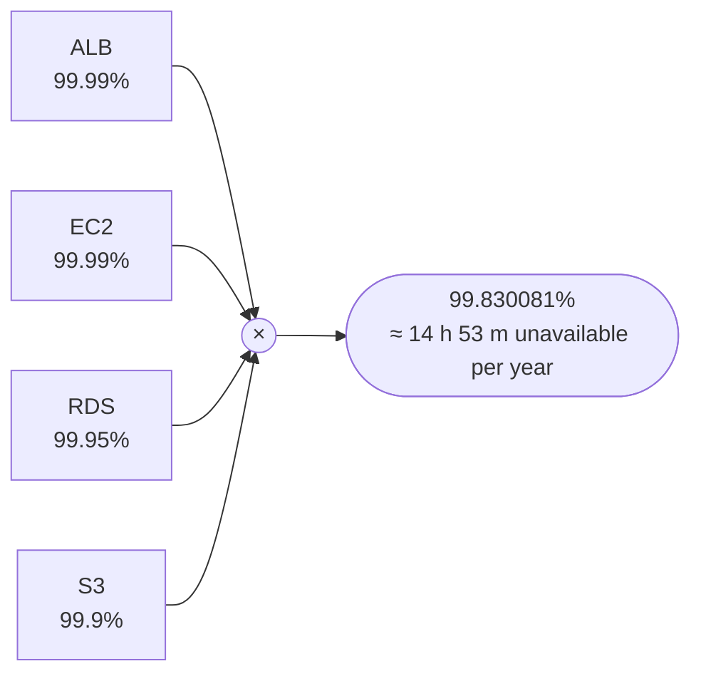
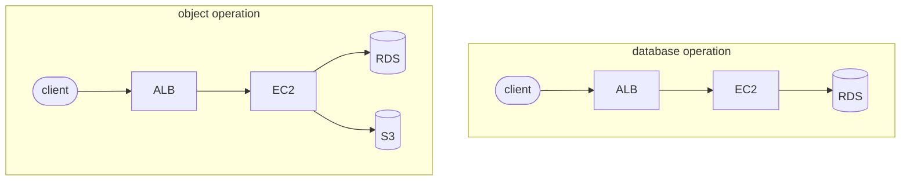
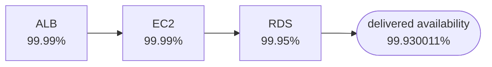
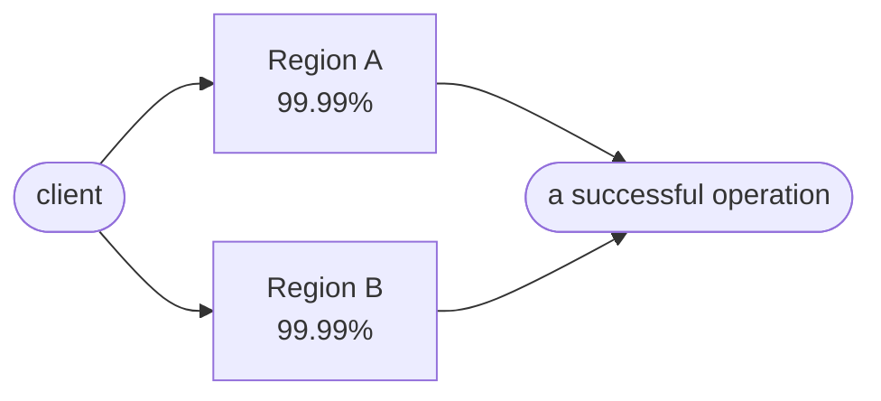
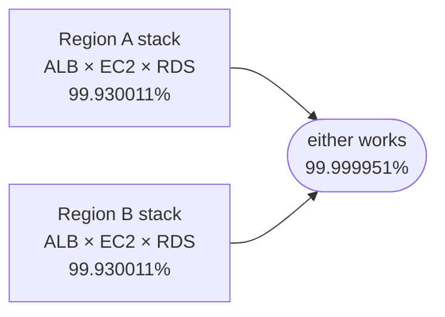

# The Tyranny of Nines

*Why the next nine costs more than the last one.*

## I had a spreadsheet

Around 2020 I was building platform tools at Twilio, and our team was adopting internal SLOs for the first time — the exercise the [Google SRE book](https://sre.google/sre-book/service-level-objectives/) had convinced the industry to take seriously. Setting an objective means proposing a number, and I went about it the way any diligent engineer would: I built a spreadsheet.

I don't remember the exact rows anymore, but I remember the method. I listed the downtime we expected to cause ourselves — deployments, maintenance windows, database migrations, the occasional incident and the time it takes to recover from one — estimated each, added them up, and subtracted from a year. Build the estimate from the inside out, from the things my team controlled. The work was careful, and it felt intuitively reasonable.

Sean Kilgore, a software architect I worked with there, taught me a great deal about leading large teams from the IC chair. Memory has compressed our exchange down to a single question, and the exact words are not recoverable, so I won't pretend to quote him. But the shape of the question survives: suppose your application were perfect and your team never caused a minute of downtime. What availability could the infrastructure underneath you actually support?

I didn't have an answer. Worse: I didn't have the spreadsheet for the answer. My rows were all about us. The question was about everything below us — about boxes and arrows I hadn't even drawn.

## What exactly are we promising?

Before any arithmetic, let's (re)define some terms, because the industry blurs them constantly.

**Availability** is the proportion of valid work that succeeds — or, in time terms, the proportion of time a service meets its defined availability condition. An **SLO** (service level objective) is the operator's internal target. An **SLA** (service level agreement) is a contract: a commitment to a customer, with measurement rules and a remedy — usually service credits — when the commitment is missed. An **error budget** is the unavailability a target permits:

| Availability | Downtime per year (approx.) |
|---:|---:|
| 99.9% | 8 h 46 m |
| 99.95% | 4 h 23 m |
| 99.99% | 52 m 34 s |
| 99.999% | 5 m 15 s |

One caveat matters enough to state before we touch a calculator. AWS publishes SLAs for its services, and we are about to multiply them together — but an SLA is a contractual commitment, not an observed failure probability, and not a physical ceiling. Services routinely perform better than their SLA. What the public SLA bounds is the promise your supplier contractually stands behind. **You can promise your customers more than your suppliers promise you — but then you are engineering the difference, self-insuring it, or both.**

One more definition, easy to skip and expensive to have skipped: availability of *what*? A service doesn't have one meaningful availability number until you name the operation and what counts as success. "Is the platform up?" is not measurable. "Do valid database requests succeed?" is. Everything that follows anchors on one customer-visible operation.

## What has to work?

Here's a service inventory much like the one we ran: an Application Load Balancer in front, EC2 instances behind it, RDS for relational data, S3 for objects. (The real platform also ran a Multi-AZ Redis cache; I'm omitting it because nothing in the analysis ahead needs it.) The numbers below are AWS's current published SLAs for well-configured deployments — a present-day model, not the contracts of 2020:

- [Multi-AZ Application Load Balancer](https://aws.amazon.com/elasticloadbalancing/sla/): 99.99%
- [EC2, Region-Level](https://aws.amazon.com/compute/sla/), which requires instances across two or more Availability Zones: 99.99%
- [Multi-AZ RDS](https://aws.amazon.com/rds/sla/): 99.95%
- [S3 Standard](https://aws.amazon.com/s3/sla/): 99.9%

Four services, four numbers. The obvious move — the one I would have made — is to multiply them:



Fourteen hours and 53 minutes of expected unavailability per year, before my team writes a single bug. Sit with that for a second, because every individual number up there looked so good.

Now let me take it back, because the method is wrong. Multiplying the inventory assumes every service is a hard dependency of every request — that membership in the architecture diagram is the same thing as being required. It isn't. What matters is the request path: which components must all work for a given operation to succeed.



A **hard dependency** is one the operation synchronously requires; it belongs in the chain. A **soft dependency** is one the service can bypass, defer, queue, or degrade around; it may not. (Hold that thought — S3 comes back in a few minutes.)

For the components that remain, here is the first form of the rule Sean's question led me to:

> **If every component must work, multiply their availabilities.**

$$A_{\text{ALL}} = A_1 \times A_2 \times \cdots \times A_n$$

For the database operation — our anchor from here on:



Notice what just happened. Everyone knows a chain is only as strong as its weakest link. The arithmetic is crueler than the proverb: a chain of dependencies is *weaker* than its weakest link, because the product sits strictly below the smallest factor. Three components, each committed north of 99.9%, and the chain they form can't support even the weakest commitment among them. **The tyranny lives in the arrows, not the boxes.**

## Why did the vendor numbers eat my budget?

Convert 99.930011% into time and the problem gets personal: about 6 hours and 8 minutes of expected annual unavailability. That is the theoretical spend of the infrastructure alone — before deployments, before bugs, before any of the incidents my spreadsheet so carefully estimated. Any objective north of 99.93% was arithmetically unsupportable by the chain beneath it, with our own downtime budgeted at zero.

Now, the honesty clause: this multiplication is a rough engineering model, not contract algebra. AWS applies each SLA separately, under its own measurement rules — S3's is computed from request error rates over five-minute intervals, RDS's from minutes of failed connections — and AWS has [never signed](https://docs.aws.amazon.com/whitepapers/latest/availability-and-beyond-improving-resilience/availability-with-dependencies.html) the composite number a customer multiplies together. Observed availability usually beats the SLA floor. The model doesn't predict your outages; it bounds your promises.

My spreadsheet wasn't wrong. It started too late. Supplier and architecture risk spend the budget before your first deploy does — the estimate has to be built from the outside in, and the spreadsheet goes last. Or, to say the same rule a different way:

> **Every hard dependency is another chance for the request to fail.**

## Do we really need S3 every time?

I promised S3 would come back. Take the object-serving version of the operation, where the response includes something stored in S3. If S3 is a hard dependency, all four services multiply, and we land exactly on the naive number from before: 99.830081%, our 14 hours and 53 minutes. That is not a coincidence; it's the definition. Multiplying the whole inventory is correct arithmetic for precisely one situation — an operation that hard-requires everything. My naive multiplication wasn't bad math. It was a correct answer to a question nobody had asked.

But suppose the application has a degraded mode: when S3 is unavailable, the operation still succeeds without the object payload — and, critically, our availability definition counts that degraded response as success. Write $f$ for the probability the degraded path actually works when called upon:

$$A = 0.99930011 \times \left[\,0.999 + 0.001 \times f\,\right]$$

| | availability | nines |
|---|---:|---:|
| $f = 0$ — no degraded mode | 99.830081% | ≈ 2.77 |
| $f = 1$ — degradation always works | 99.930011% | ≈ 3.16 |

At $f = 1$, S3 drops out of the product entirely, and the operation gets back roughly 8 hours and 45 minutes a year — essentially S3's whole downtime budget, refunded. This is the first escape from the tyranny, and notice its nature: it is architectural, not contractual. Nobody renegotiated an SLA. We demoted a dependency instead of shrinking the promise.

> **A dependency you can degrade around gives its failure chances back.**

Degrading shortens the ALL chain. There is a second escape: instead of needing fewer things, arrange to need *any* of several. That road leads somewhere bigger than a feature flag.

## What happens when the box is the Region?

Every availability number rides on a fault domain — the blast radius within which one failure is shared. In AWS terms the ladder runs instance → Availability Zone → Region. The SLAs we've been using already climbed the first rung: a single EC2 instance carries only a 99.5% commitment; the 99.99% Region-Level figure requires instances deployed across two or more AZs. Multi-AZ isn't extra credit. It's the price of admission to four nines of compute.

Our platform had paid that price — it was Multi-AZ. But all of it lived in one Region. The Region was the box everything else shared. And here's the claim that reframes the architecture conversation:

> **If the customer promise must survive the loss of a Region, the service must be able to operate without that Region.**

No amount of Multi-AZ diligence gets you there. You need a second copy, somewhere else:



Look at what changed. Within a Region, the arrows say ALL: every component must work. Between the Regions, the arrows now say ANY: the operation succeeds if *either* side works. And ANY has its own rule — the second form of the lesson:

> **If any independent alternative can work, multiply their unavailabilities — then subtract from one.**

$$A_{\text{ANY}} = 1 - \left[(1 - A_1) \times (1 - A_2) \times \cdots \times (1 - A_n)\right]$$

Run two idealized, independent, instantly interchangeable regional deployments, each at EC2's 99.99%:

$$1 - (0.0001 \times 0.0001) = 0.99999999 = 99.999999\%$$

Eight nines. The same four-nines number on each box, and the composite explodes upward instead of eroding downward — because the relationship between the boxes flipped. This is the whole lesson in one contrast, and it compresses to eight words:

> **ALL multiplies availability. ANY multiplies unavailability.**

## Did we really get eight nines?

No. But the way we didn't is instructive.

Start with an honest accounting of what's inside each Region. The eight-nines calculation paralleled the compute number alone, but each Region contains the whole anchor stack — ALB, EC2, RDS — which multiplied out to 99.930011%. Parallel the path product, not the best box's SLA:



That's 15.45 seconds of theoretical unavailability a year — six and a half nines, not eight. Still astonishing. Still not real, because even the honest version assumes:

- failures in the two Regions are independent;
- either Region has enough live capacity to carry all the traffic;
- something detects the failure and routes around it;
- the data the operation needs is present, and current enough, on the surviving side;
- certificates, secrets, configuration, and third-party dependencies exist in both places;
- failover is automatic and fast;
- no deployment or operator action can break both copies at once.

Take just one of those: speed. Six and a half nines permit about 15 seconds of downtime a year; the idealized eight nines permit a third of one second. A single, perfectly ordinary five-minute failover event — detect, decide, shift traffic — costs 99.99905% for the year all by itself. The theoretical nines aren't a promise until the recovery path earns them, one drill at a time.

And the villain lurking behind the whole list is correlation. The parallel formula multiplies *independent* failure probabilities; correlation is how supposedly independent copies fail together. Shared code. Shared data and its replication bugs. Shared control planes, shared DNS, shared feature flags. A deployment pushed to both Regions in the same hour. A human with global credentials and a bad afternoon. AWS's own [Builders Library](https://aws.amazon.com/builders-library/minimizing-correlated-failures-in-distributed-systems/) catalogs exactly these failure modes, and its [multi-Region guidance](https://docs.aws.amazon.com/prescriptive-guidance/latest/aws-multi-region-fundamentals/introduction.html) includes a warning vendors rarely print about their own upsell: an incorrectly built multi-Region architecture can *reduce* your availability.

**Two copies with a shared fate are two copies, not two alternatives.** The math only pays out if "either can work" is operationally true, and operations is where theoretical nines go to be humbled.

## What does the next nine cost?

Here's the equation everyone writes first:

```text
Cost(next nine) = 2 × hosting
```

It's wrong in both directions. A properly autoscaled active-active deployment doesn't double the hosting bill — the second Region carries real traffic, sized to demand. And the hosting bill was never the expensive part. The corrected equation looks more like:

```text
Cost(next nine) = ΔEngineering + ΔOperations + ΔNew failure modes
```

Replication semantics, and the RPO conversation you've been avoiding. Deployments that roll one Region at a time. Failover drills that actually get run, against runbooks that actually get maintained. Capacity audits, so the surviving Region can absorb the dead one's load. An on-call rotation that has to reason about two of everything, plus the seam between them. Engineer brainpower is, in general, far more expensive than hosting — and this bill is denominated almost entirely in brainpower.

**You don't buy a second copy. You buy a distributed-systems problem.** Availability doesn't improve along a smooth slope; each fault-domain boundary — instance to Multi-AZ, Multi-AZ to multi-Region — is a step function onto a qualitatively different system. And per AWS's warning above, it is entirely possible to pay the full price and receive fewer nines than you started with.

## So how should I calculate my SLA?

Here is the procedure I wish I'd had before I opened the spreadsheet:

1. Define the customer-visible operation and what counts as success — including whether degraded responses count.
2. Draw only that operation's runtime dependencies. Not the org chart, not the inventory.
3. Mark every relationship ALL, ANY, or soft — degradable, with an honest $f$.
4. Label each component with the SLA that matches its actual configuration. Multi-AZ RDS and a single RDS instance are different contracts.
5. Compute serial and parallel groups from the inside out.
6. Attack your independence assumptions: list what the "alternatives" share, because that is where parallel math goes to die.
7. Add back what the vendor numbers never covered: routing, replication, your application, deployments, detection, and recovery — including failover time.
8. Set the external promise below the modeled SLO with an explicit margin, or accept that the company is self-insuring the difference.

And when you need the whole thing at decision speed:

> **Need all of them? Multiply success. Need any of them? Multiply failure, and subtract from one.**

## What did Sean actually teach me?

The technical lesson fits on an index card, and by now you've seen it in prose, equations, a diagram, and worked numbers, so I'll spend the last repetition where it belongs: **ALL multiplies availability. ANY multiplies unavailability.**

The staff-plus lesson is quieter. Sean never touched my spreadsheet. He didn't tighten an estimate or catch an arithmetic error; he moved the boundary of the question — from the downtime my team would cause to the availability the whole system could support. He turned the calculation outside in. The spreadsheet survived, demoted to the end of the ledger, spending whatever budget remains after the dependency graph and the architecture have taken their cut. That's what architectural leadership from the IC chair often looks like: not a better answer, but a question that reveals everyone has been solving the wrong problem.

I had gone looking for our nines inside my rows — in the downtime we would cause, and the discipline we would promise. The nines were never in the rows. They were in the arrows.
