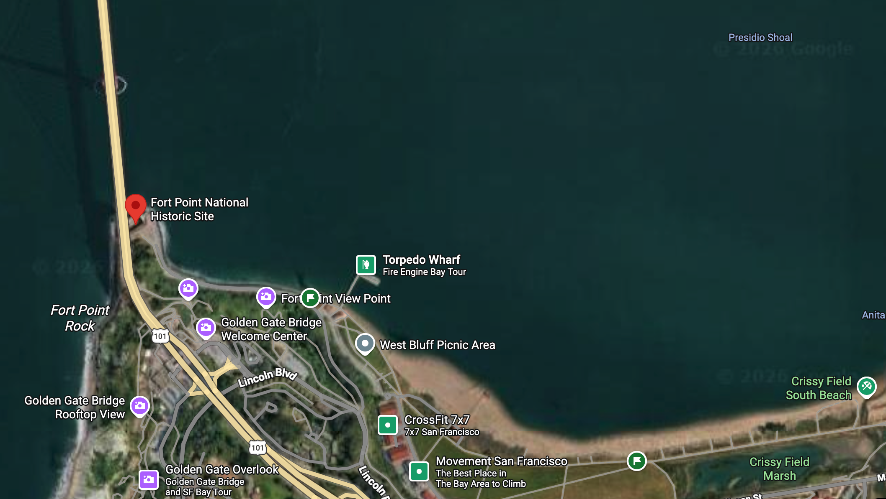
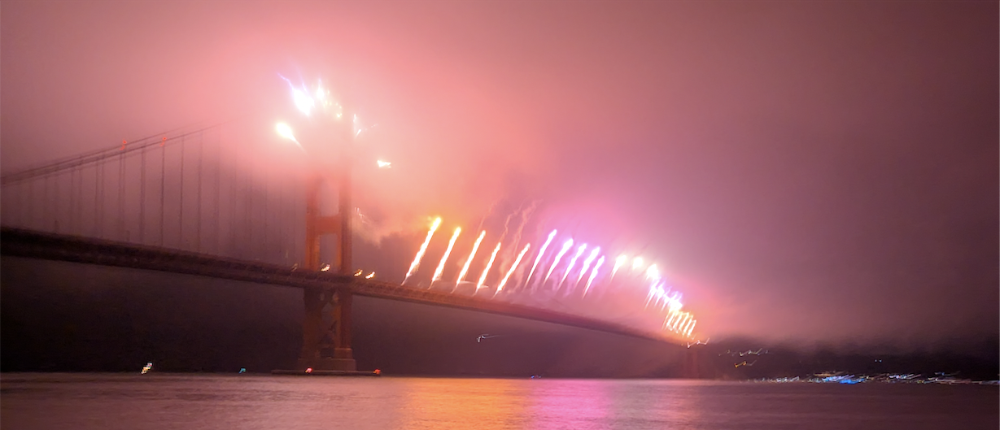
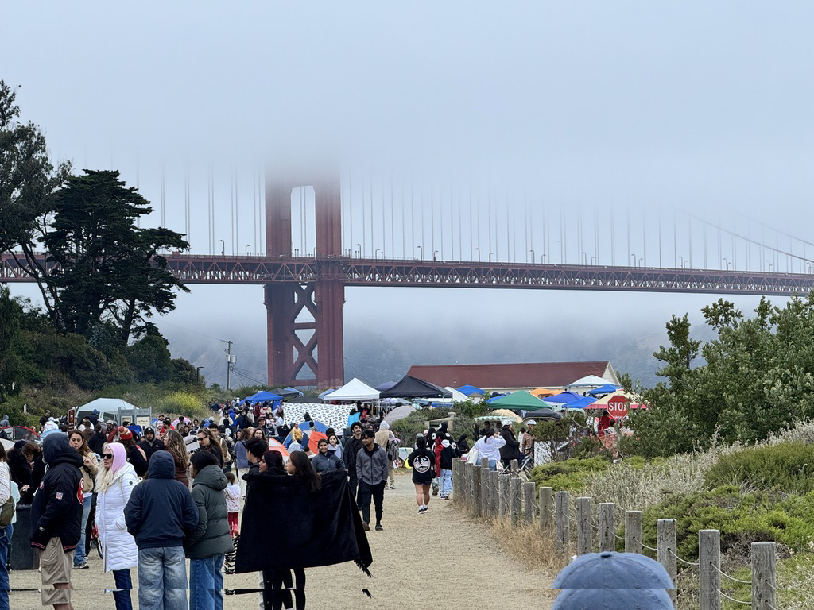
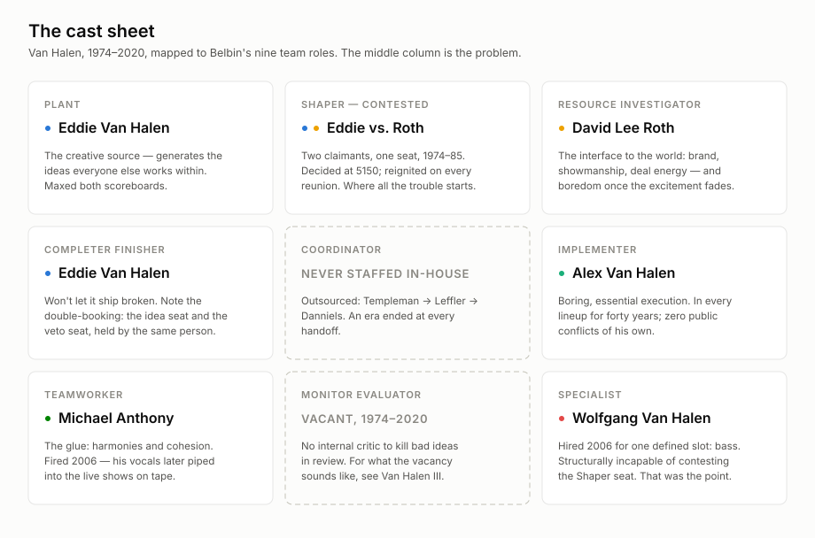
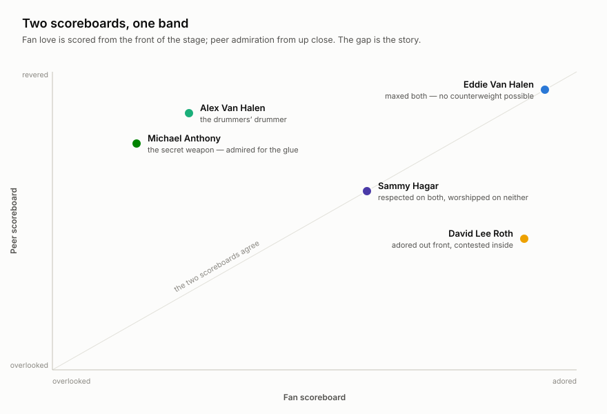

# Image reference: candidates for article placement

Curated 2026-07-12 via parallel research agents (one per theme). Every entry below had its source page fetched and its license verified; direct image URLs were confirmed live. Images are listed once, under their primary theme, with cross-references where they serve more than one. Each entry embeds the image for preview.

Marshall's own July 4, 2026 photos are now in the repo (#36–37) and take the masthead and coda slots; the GGB entries below (#8–9) are alternates only. His map screenshot (#38) fills the map placeholder, with the NPS map (#22) as the cleaner-licensing alternate.

## Licensing quick guide

- **Public domain / CC0** — use freely, no attribution required (credit is still good practice).
- **CC BY 2.0** — must credit the photographer and link the license.
- **CC BY-SA 2.0 / 4.0** — must credit, link the license, and license any modified version (e.g., a heavy crop or recolor) under the same terms. Simple embedding in the article is fine.
- **Non-free (flagged)** — two 5150 interior shots only; do not publish without permission or a deliberate fair-use call.

## At a glance

| # | Name | Theme | License |
|---|---|---|---|
| 1 | Classic lineup promo, 1984 | PLACED: Act I, at "Roth was gone" (`1984-promo.jpg`) | Public domain |
| 2 | Roth and Eddie share a frame, 2007 | Conflict | CC BY 2.0 |
| 3 | Hagar-era trio onstage, 2004 | PLACED: Act II (`2004-hagar-lineup.jpg`) | CC BY-SA 2.0 |
| 4 | Early lineup, Billboard ad, 1978 | PLACED: top of "Meet the band" (`1978-billboard-ad.jpg`) | Public domain |
| 5 | Full band performing "Jump," 2007 | Fireworks (also Conflict, Succession, Alex fallback) | CC BY 2.0 |
| 6 | Eddie airborne, Los Angeles, 1984 | Fireworks | CC BY 2.0 |
| 7 | Confetti finale, 2008 tour | Fireworks | CC BY-SA 2.0 |
| 8 | GGB fireworks, Highsmith/LOC (alternate) | Fireworks | Public domain |
| 9 | GGB fireworks from Crissy Field (alternate) | Fireworks | CC BY-SA 2.0 |
| 10 | Anthony at the mic with Satriani, 2009 | Anthony | CC BY-SA 2.0 |
| 11 | Anthony at the mic, close-up, 2009 | Anthony | CC BY-SA 2.0 |
| 12 | Anthony bass solo, 2013 (fallback) | Anthony | CC BY 2.0 |
| 13 | Eddie in front of EVH 5150 amps, 2012 | 5150 | CC BY 2.0 |
| 14 | Eddie with Frankenstein replicas, NAMM 2007 | 5150 | CC BY 2.0 |
| 15 | Eddie's Kramer guitar, EMP Museum | 5150 | CC BY 2.0 |
| 16 | 5150 Studio interior — NON-FREE | 5150 | All rights reserved |
| 17 | Eddie and Valerie at 5150, 1985 — NON-FREE | 5150 | All rights reserved |
| 18 | Fort Point under the arch | Opening scene | Public domain |
| 19 | Fort Point beneath the bridge, wide | Opening scene | Public domain |
| 20 | Looking up from the courtyard | Opening scene | CC BY-SA 4.0 |
| 21 | Brick arches, bridge in fog | Opening scene / Coda | CC0 |
| 22 | NPS map, GGNRA / Fort Point | Map placeholder | Public domain |
| 23 | Alex solo, gong halo, 2012 | Alex | CC BY 2.0 |
| 24 | Alex embedded in kit, Roth in foreground | Alex | CC BY 2.0 |
| 25 | Alex behind the kit, alternate angle | Alex | CC BY 2.0 |
| 26 | The cast sheet (custom graphic) | Cast sheet section | Own work |
| 27 | Two scoreboards (custom graphic) | "So what?" section | Own work |
| 28 | The original Frankenstrat (low-res) | Frankenstrat | Public domain |
| 29 | "Super '78 Eruption" replica rig, the Met | Frankenstrat | CC BY 2.0 |
| 30 | Vester clone, body close-up | Frankenstrat | CC BY 2.0 |
| 31 | *1984* cover — fair use | PLACED: Act I, fait accompli (`cover-1984.jpg`) | Fair use (low-res) |
| 32 | *5150* cover — fair use | PLACED: Interlude close (`cover-5150.jpg`) | Fair use (low-res) |
| 33 | Wolfgang on bass, Montreal 2007 | Succession | CC BY 2.0 |
| 34 | Eddie soloing, Montreal 2007 | Succession / Conflict | CC BY 2.0 |
| 35 | Wolfgang on bass, Minneapolis 2012 | Succession | CC BY 2.0 |
| 36 | Opening salvo at the south tower (Marshall's photo) | Opening / coda | Own work |
| 37 | Cascade lighting the fog (Marshall's photo) | Source of masthead crop | Own work |
| 38 | Map to Fort Point (Google Maps screenshot) | PLACED: beside #40 | Google Maps — keep attribution |
| 39 | Masthead banner crop | PLACED: top of post | Own work |
| 40 | Crowd walking to Fort Point in fog | PLACED: beside #38 | Own work |
| 41 | Eddie live, Sacramento 2004 | PLACED: Act III close (`2004-eddie-live.jpg`) | CC BY 3.0 |
| 42 | *Van Halen III* cover — fair use | PLACED: Act III, album paragraph (`cover-van-halen-iii.jpg`) | Fair use (low-res) |

---

## Creative conflict

### 1. Classic lineup promo, 1984

Official Warner Bros. Records publicity photo of the classic lineup — Alex, Roth, Eddie, Anthony — from the *1984* album year, months before Roth's exit. The visual record of the lineup at its commercial peak, right before the rupture over musical direction. Also serves the 5150 theme: *1984* was the first album recorded there.

- **Image:** https://upload.wikimedia.org/wikipedia/commons/7/72/Van_Halen_Lineup_1984.jpg
- **Source:** Wikimedia Commons — https://commons.wikimedia.org/wiki/File:Van_Halen_Lineup_1984.jpg
- **Credit:** Warner Bros. Records promotional photo, photographer uncredited
- **License:** Public domain (PD-US-1978-89: published in the US without copyright notice, not registered within 5 years). Caveat: some non-US jurisdictions without the rule of the shorter term may still assert copyright.

### 2. Roth and Eddie share a frame, 2007

Roth and Eddie together onstage during the 2007 reunion tour (Bell Centre, Montreal, Nov 10 2007) — the two rival personas sharing a stage after 22 years, on a tour that was itself notoriously contentious behind the scenes. The cleanest "creative conflict" two-shot in the set.

- **Image:** https://upload.wikimedia.org/wikipedia/commons/a/a8/David_Lee_Roth_and_Eddie_Van_Halen_2007-11-10.jpg
- **Source:** Wikimedia Commons — https://commons.wikimedia.org/wiki/File:David_Lee_Roth_and_Eddie_Van_Halen_2007-11-10.jpg
- **Credit:** Anirudh Koul (via Flickr)
- **License:** CC BY 2.0

### 3. Hagar-era trio onstage, 2004

Michael Anthony, Sammy Hagar, and Eddie Van Halen onstage during the 2004 reunion tour — the other frontman occupying Roth's old spot, and the last tour before Anthony's firing. Also useful in the Anthony thread as a lineup/context shot (note: Hagar is at the mic here, not Anthony). A tighter crop centered on Anthony exists on Commons as `File:Michael_Anthony-Van_HalenwithHagar.jpg` (same photographer, same license).

- **Image:** https://upload.wikimedia.org/wikipedia/commons/1/1f/VanHalenwithHagar.jpg
- **Source:** Wikimedia Commons — https://commons.wikimedia.org/wiki/File:VanHalenwithHagar.jpg
- **Credit:** Flickr user "bella lago"
- **License:** CC BY-SA 2.0

### 4. Early lineup, Billboard ad, 1978

The band in a February 4, 1978 Billboard magazine advertisement, right as the debut album broke. Origin-point bookend for the arc from formation to rupture.

- **Image:** https://upload.wikimedia.org/wikipedia/commons/6/6a/Van_Halen_%281978%29.jpg
- **Source:** Wikimedia Commons — https://commons.wikimedia.org/wiki/File:Van_Halen_(1978).jpg
- **Credit:** Billboard magazine advertisement (Feb 4, 1978, p. 31), photographer uncredited
- **License:** Public domain (PD-US-1978-89, same caveat as #1)

---

## Fireworks

Research note: no freely licensed photo of Van Halen's literal onstage pyro exists — the famous flash-pot-era shots (1980 tour, US Festival '83) are all Getty/Alamy rights-managed. The entries below are the closest free equivalents. The masthead and coda use Marshall's own July 4, 2026 photos; #8–9 are alternates only.

### 5. Full band performing "Jump," 2007

Roth mid-jump beside Eddie, Wolfgang, and Alex (VH-logo kick drum visible), performing "Jump" at the same Nov 10 2007 Montreal show as #2. Direct visual tie to the "'Jump' landing on the first salvo" beat; also works as a full-band reunion shot for the conflict thread. Two bonus readings from later research passes: (a) Alex is a small, partly obscured figure at the back — on-theme for the Implementer; (b) **Eddie and Wolfgang are both airborne mid-jump in the same frame** (verified by cross-matching wardrobe against the photographer's same-night solo portraits), making this the only confirmed father-and-son same-frame shot in the free set — the succession beat's hero image.

- **Image:** https://upload.wikimedia.org/wikipedia/commons/6/6a/Van_Halen_-_Jump_2007-11-10.jpg
- **Source:** Wikimedia Commons — https://commons.wikimedia.org/wiki/File:Van_Halen_-_Jump_2007-11-10.jpg
- **Credit:** Anirudh Koul (via Flickr)
- **License:** CC BY 2.0

### 6. Eddie airborne, Los Angeles, 1984

Black-and-white shot of Eddie mid-leap onstage during a 1984-tour performance in LA — the exact album/tour year the post centers on. No pyro, but explosive in its own right and perfectly period-matched.

- **Image:** https://upload.wikimedia.org/wikipedia/commons/f/f9/Los_Angeles-based_band_Van_Halen%2C_guitarist_Eddie_Van_Halen_airborne_during_performance_in_Los_Angeles%2C_Calif.%2C_1984_%2822195741815%29.jpg
- **Source:** Wikimedia Commons — https://commons.wikimedia.org/wiki/File:Los_Angeles-based_band_Van_Halen,_guitarist_Eddie_Van_Halen_airborne_during_performance_in_Los_Angeles,_Calif.,_1984_(22195741815).jpg
- **Credit:** Los Angeles Times Photographic Archive, UCLA Library Special Collections (via Flickr Commons)
- **License:** CC BY 2.0

### 7. Confetti finale, 2008 tour

Full band taking a bow under a burst of confetti and stage light (May 25, 2008) — the closest freely licensed visual to an indoor "fireworks moment." Backup alternative: a 2007 Toronto laser-show shot, `File:Van_Halen_027.jpg` (CC BY-SA 3.0 / GFDL, by Commons user De-fexxx666), if a sky-beam look works better than confetti.

- **Image:** https://upload.wikimedia.org/wikipedia/commons/b/ba/VAN_HALEN_2008.jpg
- **Source:** Wikimedia Commons — https://commons.wikimedia.org/wiki/File:VAN_HALEN_2008.jpg
- **Credit:** Flickr user GHOSTRIDER2112
- **License:** CC BY-SA 2.0

### 8. Fireworks over the Golden Gate Bridge (Highsmith/LOC) — alternate

Fireworks bursting over the bridge during its 75th-anniversary celebration, May 2012. Superseded by Marshall's own July 4, 2026 photos; kept as a public-domain alternate. The original file is TIFF; the embed above is the 960px JPEG rendering.

- **Image (JPEG preview):** https://upload.wikimedia.org/wikipedia/commons/thumb/8/84/Golden_Gate_Bridge_75th_Anniversary_fireworks_in_San_Francisco%2C_California_LCCN2013630498.tif/lossy-page1-960px-Golden_Gate_Bridge_75th_Anniversary_fireworks_in_San_Francisco%2C_California_LCCN2013630498.tif.jpg
- **Image (TIFF original):** https://upload.wikimedia.org/wikipedia/commons/8/84/Golden_Gate_Bridge_75th_Anniversary_fireworks_in_San_Francisco%2C_California_LCCN2013630498.tif
- **Source:** Wikimedia Commons — https://commons.wikimedia.org/wiki/File:Golden_Gate_Bridge_75th_Anniversary_fireworks_in_San_Francisco,_California_LCCN2013630498.tif
- **Credit:** Carol M. Highsmith, Library of Congress (Jon B. Lovelace Collection)
- **License:** Public domain (Highsmith dedicated her LOC-donated work to the public; no known restrictions)

### 9. GGB fireworks from Crissy Field — alternate

Same 75th-anniversary fireworks, photographed from Crissy Field — geographically the closest match to the post's Fort Point vantage. Superseded by Marshall's own photos; kept as an alternate.

- **Image:** https://upload.wikimedia.org/wikipedia/commons/3/3c/GGB_75th_Anniversary_Fireworks_%28Update_-_Explored_5-28-2012%29_-_Flickr_-_zoxcleb.jpg
- **Source:** Wikimedia Commons — https://commons.wikimedia.org/wiki/File:GGB_75th_Anniversary_Fireworks_(Update_-_Explored_5-28-2012)_-_Flickr_-_zoxcleb.jpg
- **Credit:** Flickr user "zoxcleb"
- **License:** CC BY-SA 2.0

---

## Michael Anthony singing harmonies

Research note: no CC-licensed 1980s–90s Van Halen-era concert photos of Anthony exist — pre-2000s VH concert photography is essentially all agency-owned. The best "at the mic" shots are Chickenfoot-era (2009), which arguably suits the post's point: the glue guy kept singing after the firing.

### 10. Anthony at the mic with Satriani, Chickenfoot 2009

Anthony leaning into a mic mid-vocal, playing his EVH-style bass, beside Joe Satriani (Chickenfoot at El Corazon, May 14, 2009). One of the two strongest harmony-singing candidates.

- **Image:** https://upload.wikimedia.org/wikipedia/commons/a/a2/Joe_Satriani_%26_Michael_Anthony.jpg
- **Source:** Wikimedia Commons — https://commons.wikimedia.org/wiki/File:Joe_Satriani_%26_Michael_Anthony.jpg
- **Credit:** ArtBrom (via Flickr)
- **License:** CC BY-SA 2.0

### 11. Anthony at the mic, close-up, 2009

Tight shot of Anthony alone at a mic stand, mouth open, playing bass — the cleanest close-up "at the mic" image found. Same show and photographer as #10 (one shoot, not independent sources).

- **Image:** https://upload.wikimedia.org/wikipedia/commons/8/88/Michael_Anthony_%28bassist%29.jpg
- **Source:** Wikimedia Commons — https://commons.wikimedia.org/wiki/File:Michael_Anthony_(bassist).jpg
- **Credit:** ArtBrom (via Flickr)
- **License:** CC BY-SA 2.0

### 12. Anthony bass solo, 2013 (fallback)

Black-and-white shot of Anthony mid-solo, no mic in frame — a playing-only fallback, and low resolution (375×500), so judge usability before embedding.

- **Image:** https://upload.wikimedia.org/wikipedia/commons/d/df/Michael_Anthony.jpg
- **Source:** Wikimedia Commons — https://commons.wikimedia.org/wiki/File:Michael_Anthony.jpg
- **Credit:** Kristy Fox (via Flickr)
- **License:** CC BY 2.0

For a Van Halen-era Anthony shot, see #3 (2004 Hagar-era trio) and its Anthony-centered crop.

---

## 5150 studio

Research note: no freely licensed images of the actual 5150 Studios building, interior, or console exist anywhere — Commons has no file, and Flickr CC search came up empty. Entries 13–15 are verified free adjacent artifacts that carry the "own the means of production" thread; 16–17 are the canonical non-free interior shots, flagged.

### 13. Eddie in front of EVH 5150 amps, 2012

Eddie performing live (Xcel Energy Center, May 19, 2012) directly in front of his signature EVH 5150-branded amp stack — the "5150" name made literally visible on stage gear.

- **Image:** https://upload.wikimedia.org/wikipedia/commons/7/74/Eddie_van_Halen_on_stage_in_front_of_EVH_5150_amps_%28vertical_crop%29.jpg
- **Source:** Wikimedia Commons — https://commons.wikimedia.org/wiki/File:Eddie_van_Halen_on_stage_in_front_of_EVH_5150_amps_(vertical_crop).jpg
- **Credit:** Joe Bielawa (via Flickr)
- **License:** CC BY 2.0

### 14. Eddie with Frankenstein replicas, NAMM 2007

Eddie at the January 2007 NAMM Show with Fender Custom Shop "Frankenstein" replicas — the moment his signature instrument became a product line, extending the means-of-production thread from studio to gear and brand.

- **Image:** https://upload.wikimedia.org/wikipedia/commons/c/cd/Eddie_Van_Halen_himself_and_EVH_Frankenstein_replicas%2C_NAMM_2007.jpg
- **Source:** Wikimedia Commons — https://commons.wikimedia.org/wiki/File:Eddie_Van_Halen_himself_and_EVH_Frankenstein_replicas,_NAMM_2007.jpg
- **Credit:** Flickr user "Incase"
- **License:** CC BY 2.0

### 15. Eddie's Kramer guitar, EMP Museum

Eddie's guitar and Marshall gear on display at Seattle's EMP Museum, 2011. **Identification correction (round-two research):** the Commons title is generic, but the English Wikipedia Frankenstrat article identifies this exact photo as **the Kramer guitar made by Eddie Van Halen** — his Kramer-era instrument, not the Frankenstrat. Still usable as an enshrined-gear artifact, but caption it as the Kramer.

- **Image:** https://upload.wikimedia.org/wikipedia/commons/5/52/Eddie_Van_Halen%27s_guitar%2C_EMP_Museum.jpg
- **Source:** Wikimedia Commons — https://commons.wikimedia.org/wiki/File:Eddie_Van_Halen%27s_guitar,_EMP_Museum.jpg
- **Credit:** John Seb Barber (via Flickr)
- **License:** CC BY 2.0

For a lineup shot tied to 5150's first album, see #1 (the *1984* promo, public domain).

### 16. 5150 Studio interior — NON-FREE, flagged

Interior photo of the actual 5150 control room/studio space, from The Tapes Archive's "Building 5150 Studio" article. The only interior shot found; the closest image to the interlude's literal subject. **Do not publish without permission** — the site is "Copyright 2023 The Tapes Archive LLC," no reuse grant. If any non-free image is worth pursuing licensing for, it's this one.

- **Image:** https://www.thetapesarchive.com/wp-content/uploads/2023/05/Edward-Van-Halens-5150-Studio.png
- **Source:** The Tapes Archive — https://www.thetapesarchive.com/van-halen/building-5150-studio-article/
- **Credit:** Photo credited to Bonnie Parkinson; published by The Tapes Archive LLC
- **License:** Non-free / all rights reserved

### 17. Eddie and Valerie Bertinelli at 5150, 1985 — NON-FREE, flagged

A 1985 photo of Eddie and then-wife Valerie Bertinelli at 5150, published as an exclusive by Van Halen News Desk. Rare shot of Eddie personally at the studio in-era. **Do not publish** — no license stated, and the original photographer is unknown, which adds an attribution risk on top of the copyright question.

- **Image:** https://www.vhnd.com/wp-content/uploads/2013/04/AAP10.jpg
- **Source:** Van Halen News Desk — https://www.vhnd.com/2013/04/27/vhnds-all-access-photo-5150-studio/
- **Credit:** Original photographer unknown; published by VHND (not affiliated with Van Halen/ELVH, Inc.)
- **License:** Non-free / all rights reserved

---

## Opening scene: Fort Point under the deck

Round-two research. All four photos verified via the MediaWiki API's license metadata, not scraped page text.

### 18. Fort Point under the arch

Fort Point's brick facade with the bridge's steel arch span filling the sky directly overhead — the classic "fort dwarfed by the bridge" composition.

- **Image:** https://upload.wikimedia.org/wikipedia/commons/d/dd/Fort_Point_under_the_Golden_Gate_Bridge.JPG
- **Source:** Wikimedia Commons — https://commons.wikimedia.org/wiki/File:Fort_Point_under_the_Golden_Gate_Bridge.JPG
- **Credit:** Dvortygirl (Commons user), June 2005
- **License:** Public domain (released by the copyright holder)

### 19. Fort Point beneath the bridge, wide

Wide view of Fort Point sitting directly beneath the bridge deck, showing the scale relationship between the fort and the span above it.

- **Image:** https://upload.wikimedia.org/wikipedia/commons/5/5c/Golden_Gate_Bridge_and_Fort_Point_2009b.jpg
- **Source:** Wikimedia Commons — https://commons.wikimedia.org/wiki/File:Golden_Gate_Bridge_and_Fort_Point_2009b.jpg
- **Credit:** Commons user "Leaflet" (own work), 2009
- **License:** Public domain (self-dedicated)

### 20. Looking up from the courtyard

From Fort Point's inner courtyard looking straight up at the underside of the bridge deck — the closest match to the post's "shells in our chests," directly-underneath vantage.

- **Image:** https://upload.wikimedia.org/wikipedia/commons/5/5b/Fort_point_under_the_gg_bridge.jpg
- **Source:** Wikimedia Commons — https://commons.wikimedia.org/wiki/File:Fort_point_under_the_gg_bridge.jpg
- **Credit:** Commons user "Mglindervmd" (own work)
- **License:** CC BY-SA 4.0

### 21. Brick arches, bridge in fog

The bridge deck in fog seen from below, with Fort Point's brick arcade in the foreground — a moodier take that could also pair with the coda if Marshall's own fog photo needs a companion.

- **Image:** https://upload.wikimedia.org/wikipedia/commons/f/f7/BigRedBridge%26brickArches%28byCharlieFoster%29.jpg
- **Source:** Wikimedia Commons — https://commons.wikimedia.org/wiki/File:BigRedBridge%26brickArches(byCharlieFoster).jpg
- **Credit:** Charlie Foster (via Unsplash)
- **License:** CC0 (public domain dedication)

### 22. NPS map, GGNRA / Fort Point (map placeholder)

NPS overview map of the Golden Gate National Recreation Area, including Fort Point NHS and the Presidio, for the `[insert map picture here]` placeholder. A tighter option: the NPS Presidio "Pad Map" (labels Fort Point, Crissy Field, the Warming Hut) at https://www.nps.gov/goga/planyourvisit/upload/Pad-Map-9-15_color_print1.pdf — also public domain, but it's a PDF and would need a page-to-image export.

- **Image:** https://upload.wikimedia.org/wikipedia/commons/c/c8/Map_of_Golden_Gate_National_Recreation_Area.png
- **Source:** Wikimedia Commons — https://commons.wikimedia.org/wiki/File:Map_of_Golden_Gate_National_Recreation_Area.png
- **Credit:** U.S. National Park Service
- **License:** Public domain (US federal government work)

---

## Alex Van Halen, the Implementer

Round-two research. All CC BY 2.0; each visually inspected before selection.

### 23. Alex solo, gong halo, 2012

Alex alone at his kit, mid-strike, sunglasses on, framed by the giant Paiste gong and Ludwig double-bass kit — the definitive "canon among drummers, invisible to the crowd" shot. A pre-cropped portrait variant exists as `File:Alex_Van_Halen_-_Van_Halen_Live_(cropped).jpg` (same author/license).

- **Image:** https://upload.wikimedia.org/wikipedia/commons/b/b3/Alex_Van_Halen_-_Van_Halen_Live.jpg
- **Source:** Wikimedia Commons — https://commons.wikimedia.org/wiki/File:Alex_Van_Halen_-_Van_Halen_Live.jpg
- **Credit:** Craig ONeal (via Flickr), April 16, 2012
- **License:** CC BY 2.0

### 24. Alex embedded in kit, Roth in foreground

The massive gold Ludwig kit and full-circle gong form a halo around Alex mid-performance, with Roth singing in soft-focus foreground — visually enacting "invisible engine, visible frontman."

- **Image:** https://upload.wikimedia.org/wikipedia/commons/d/d3/VH.DSC_0344.5_19_12_%287235717042%29.jpg
- **Source:** Wikimedia Commons — https://commons.wikimedia.org/wiki/File:VH.DSC_0344.5_19_12_(7235717042).jpg
- **Credit:** Joe Bielawa, Xcel Energy Center, St. Paul MN, May 19, 2012
- **License:** CC BY 2.0

### 25. Alex behind the kit, alternate angle

Same 2012 show, alternate angle: Alex behind the gold kit with the Ludwig branding prominent, Roth again in the foreground. Use if two kit shots are needed without repeating composition.

- **Image:** https://upload.wikimedia.org/wikipedia/commons/9/9b/VH.DSC_0184.5_19_12_%287235634478%29.jpg
- **Source:** Wikimedia Commons — https://commons.wikimedia.org/wiki/File:VH.DSC_0184.5_19_12_(7235634478).jpg
- **Credit:** Joe Bielawa, Xcel Energy Center, St. Paul MN, May 19, 2012
- **License:** CC BY 2.0

Wide-shot fallback: #5 (the 2007 "Jump" photo), where Alex is a small, partly obscured figure at the back.

---

## The Frankenstrat (the Plant's own tooling)

Round-two research, with an honest bottom line: freely licensed tight close-ups of the actual red/black/white Frankenstrat are scarce. Only #30 (an unofficial clone) is both free and a genuine close-up. Dead ends checked: the Smithsonian's "Frank 2" replica exists (object nmah_1397533, reportedly CC0) but si.edu blocked all fetch attempts (HTTP 403) and it isn't mirrored on Commons — worth a manual visit to americanhistory.si.edu if a museum-grade shot is wanted.

### 28. The original Frankenstrat (low-res)

Captioned by Wikipedia editors as the original Frankenstein Eddie built — an editorial assertion, no documented provenance. Only 288×208px, so likely too small to publish without unacceptable upscaling; included as the only asserted-authentic free image.

- **Image:** https://upload.wikimedia.org/wikipedia/commons/4/40/EVH_frankenstrat.jpg
- **Source:** Wikimedia Commons — https://commons.wikimedia.org/wiki/File:EVH_frankenstrat.jpg
- **Credit:** Uploaded by English Wikipedia user "Bainzy," self-released
- **License:** Public domain (released by uploader)

### 29. "Super '78 Eruption" replica rig, the Met, 2019

Eddie's reconstructed 1978 stage rig at the Met's "Play It Loud" exhibit, with a 2018 EVH Custom Shop replica. Two caveats: it's the white-with-black-stripe "Eruption '78" configuration (not the famous red/black/white scheme), and it's a wide rig shot, not a close-up — context material, not the icon.

- **Image:** https://upload.wikimedia.org/wikipedia/commons/8/81/Eddie_Van_Halen%27s_2018_EVH_%22Super_%2778_Eruption%22_replica_%28white_with_black_stripe%29%2C_Rig_including_4%C3%97Marshall_412_cab._%281960s%29%2C_Marshall_1959_Super_Lead_%281960s%29%2C_etc._-_Play_It_Loud._MET_%282019-05-13_19.17.13_by_Eden%2C_Janine_and_Jim%29.jpg
- **Source:** Wikimedia Commons — https://commons.wikimedia.org/wiki/File:Eddie_Van_Halen%27s_2018_EVH_%22Super_%2778_Eruption%22_replica_(white_with_black_stripe),_Rig_including_4%C3%97Marshall_412_cab._(1960s),_Marshall_1959_Super_Lead_(1960s),_etc._-_Play_It_Loud._MET_(2019-05-13_19.17.13_by_Eden,_Janine_and_Jim).jpg
- **Credit:** Eden, Janine and Jim (via Flickr)
- **License:** CC BY 2.0

For Eddie posing with official Frankenstein replicas, see #14 (NAMM 2007) — a booth/event shot, not a close-up.

### 30. Vester clone, body close-up

A genuine tight macro of the red/black/white stripe scheme — on an unofficial third-party Vester clone, not the original or a licensed replica. The only free image that is actually a close-up; the caption must be honest that it's a tribute build. Five more angles of the same guitar exist in Commons Category:Frankenstrat clones (same author/license).

- **Image:** https://upload.wikimedia.org/wikipedia/commons/a/aa/Vester_Frankenstrat_-_body_details_-_Sir_Theo%2C_Belgaum%2C_India_%282011-11-23_08.10.30_by_julian_correa%29.jpg
- **Source:** Wikimedia Commons — https://commons.wikimedia.org/wiki/File:Vester_Frankenstrat_-_body_details_-_Sir_Theo,_Belgaum,_India_(2011-11-23_08.10.30_by_julian_correa).jpg
- **Credit:** Julian Correa (via Flickr), 2011
- **License:** CC BY 2.0

---

## Album covers (non-free, editorial fair use)

All verified via the Wikipedia API as tagged non-free with a stated use rationale. Low-res use in commentary about the album is standard editorial practice, but it's a judgment call, not a license. **Marshall made that call 2026-07-14 ("album photos … are fair use") — the covers below are cleared for this post.**

### 31. *1984* album cover — NON-FREE fair use

Margo Nahas's smoking-cherub painting, 320×320px. Placement candidates: the opening scene (the album that scored the show) or the Act I "Jump" fait accompli.

- **Image:** https://upload.wikimedia.org/wikipedia/en/5/5f/Van_Halen_-_1984.jpg
- **Source:** English Wikipedia — https://en.wikipedia.org/wiki/File:Van_Halen_-_1984.jpg
- **Credit:** Warner Bros. Records; art by Margo Nahas
- **License:** Non-free fair-use (Wikipedia low-res)

### 32. *5150* album cover — NON-FREE fair use

Atlas kneeling under the mirror-polished sphere (model: Rick Valente), 300×300px. Placement candidate: the Interlude's closing line — "The side branch had become main." A man holding up the world alone is accidentally on-theme.

- **Image:** https://upload.wikimedia.org/wikipedia/en/1/12/VanHalen_5150_fcover.jpg
- **Source:** English Wikipedia — https://en.wikipedia.org/wiki/File:VanHalen_5150_fcover.jpg
- **Credit:** Warner Bros. Records
- **License:** Non-free fair-use (Wikipedia low-res)

### 42. *Van Halen III* cover — fair use

Sepia photo of a strongman taking a cannonball to the stomach, 300×294px. **Placed in the draft** (as `images/cover-van-halen-iii.jpg`) at Act III's *Van Halen III* paragraph — the album the post calls the sound of the **Monitor Evaluator** vacancy.

- **Image:** https://upload.wikimedia.org/wikipedia/en/b/bf/Van_Halen_-_Van_Halen_III.jpg
- **Source:** English Wikipedia — https://en.wikipedia.org/wiki/File:Van_Halen_-_Van_Halen_III.jpg
- **Credit:** Warner Bros. Records
- **License:** Non-free fair-use (Wikipedia low-res)

---

## Eddie & Wolfgang: the succession

Round-two research. Honest limitation: no tight father-and-son two-shot exists in the free set — both photographers shot Eddie and Wolfgang in disjoint bursts. The succession hero image is #5 (both airborne in the same "Jump" frame, verified); the entries below are the supporting solo shots. Eddie in front of the 5150 amps (#13) is from the same 2012 show as #35.

### 33. Wolfgang on bass, Montreal 2007

Wolfgang (16 at the time) playing bass, backlit in orange stage light, at the same Bell Centre show as the "Jump" frame — the new guy's first tour, in his father's band.

- **Image:** https://upload.wikimedia.org/wikipedia/commons/5/54/Wolfgang_Van_Halen_2007-11-10.jpg
- **Source:** Wikimedia Commons — https://commons.wikimedia.org/wiki/File:Wolfgang_Van_Halen_2007-11-10.jpg
- **Credit:** Anirudh Koul (via Flickr)
- **License:** CC BY 2.0

### 34. Eddie soloing, Montreal 2007

Eddie performing "Eruption," shirtless in camo pants, on his Peavey EVH Wolfgang guitar — a sharp, high-resolution close-up, and the guitar model is literally named after his son, which is a caption gift for the succession beat.

- **Image:** https://upload.wikimedia.org/wikipedia/commons/0/0f/Eddie_Van_Halen_2007-11-10.jpg
- **Source:** Wikimedia Commons — https://commons.wikimedia.org/wiki/File:Eddie_Van_Halen_2007-11-10.jpg
- **Credit:** Anirudh Koul (via Flickr)
- **License:** CC BY 2.0

### 35. Wolfgang on bass, Minneapolis 2012

Wolfgang at 21, on his white/black-striped EVH bass, "A Different Kind of Truth" tour at Xcel Energy Center — five years into the seat, playing an instrument in his father's stripe scheme.

- **Image:** https://upload.wikimedia.org/wikipedia/commons/0/0c/Wolfgang_Van_Halen_Different_Kind_of_Truth_2012.jpg
- **Source:** Wikimedia Commons — https://commons.wikimedia.org/wiki/File:Wolfgang_Van_Halen_Different_Kind_of_Truth_2012.jpg
- **Credit:** Joe Bielawa (via Flickr)
- **License:** CC BY 2.0

### 41. Eddie live, Sacramento 2004

Eddie alone in heavy orange stage light, shirtless in camo pants on a sunburst guitar, Sacramento, August 11, 2004 (round-three addition, supplied by Marshall). License verified via the Commons API 2026-07-14. **Placed in the draft** (as `images/2004-eddie-live.jpg`) at the close of Act III, after "arranged exactly as he'd built it."

- **Image:** https://upload.wikimedia.org/wikipedia/commons/5/57/Edward_Van_Halen_live_2004-08-11.jpg
- **Source:** Wikimedia Commons — https://commons.wikimedia.org/wiki/File:Edward_Van_Halen_live_2004-08-11.jpg
- **Credit:** Commons user "Mogwai73" (own work)
- **License:** CC BY 3.0

---

## Marshall's own photos (July 4, 2026, Fort Point)

In `drafting/van-halen/images/`. Both fireworks shots are ~22 MB full-resolution PNGs — export downscaled web versions (JPEG/WebP) before publishing; don't serve these directly.

### 36. Opening salvo at the south tower

A single starburst breaking through the fog beside the south tower, the tower lit gold, a silhouetted watcher on the rocks in the foreground. This is the opening scene's beat — the first shells off the deck — and the natural masthead.

- **File:** `images/2026-07-04-opening-salvo.png` (2116×1194)
- **License:** Own work

### 37. Cascade lighting the fog

A deck-length cascade of comets pouring off the roadway, the fog glowing pink and gold from inside, watcher silhouetted below. This is the coda's sentence — "the low-level effects off the deck still lit the fog from inside" — as a photograph.

- **File:** `images/2026-07-04-bright-colorful-bridge.png` (3072×2061)
- **License:** Own work

### 38. Map to Fort Point

Google Maps satellite view: the Fort Point National Historic Site pin directly under the bridge approach, with Crissy Field and the shoreline walk east of it — the hike route in one frame. **Placed in the draft** beside #40, after the "hiked out to Fort Point" paragraph.

- **File:** `images/map-to-fort-point.png` (3072×2075)
- **License:** Google Maps screenshot — Google's geo guidelines permit editorial blog use provided the "© Google" attribution baked into the image stays visible (it's in the frame). If cleaner licensing is preferred, swap for the public-domain NPS map (#22).

### 39. Masthead banner crop

Wide banner crop of #37 (the deck cascade lighting the fog), prepared by Marshall for the top of the post. **Placed in the draft** as the masthead, replacing the placeholder.

- **File:** `images/masthead.png` (web-ready, ~1 MB)
- **License:** Own work

### 40. Crowd walking to Fort Point in fog

Daytime, July 4: the crowd streaming down the path toward Fort Point, tents pitched, the bridge towers already swallowed by Karl — the "hiked out to Fort Point" scene with the fog's all-day presence established on camera. **Placed in the draft** beside the map (#38).

- **File:** `images/foggy-bridge-with-crowd.png` (~1.2 MB)
- **License:** Own work

---

## Custom graphics (own work, no licensing constraints)

Both built to the house dataviz method: palette validated for colorblind safety and contrast in light and dark modes, member colors consistent across both graphics (Eddie blue, Alex aqua, Roth yellow, Anthony green, Hagar violet, Wolfgang red), and each supports dark mode automatically via `prefers-color-scheme`.

### 26. The cast sheet

Belbin role grid for the "Meet the band" section: nine seats, the middle column deliberately hollow — Shaper contested (Eddie vs. Roth), Coordinator never staffed in-house, Monitor Evaluator vacant 1974–2020.

- **File:** `drafting/van-halen/images/cast-sheet.svg`
- **License:** Own work

### 27. Two scoreboards, one band

Scatter for the "So what?" section: fan scoreboard vs. peer scoreboard, with the agreement diagonal. Eddie sits on the line at the top; Hagar on the line in the middle; Alex and Anthony float far above it; Roth sits below. The vertical gap to the diagonal is claim #3 made visible.

- **File:** `drafting/van-halen/images/two-scoreboards.svg`
- **License:** Own work

---

## Rejected candidates (for the record)

- `Van_Halen_in_concert_(20241474465).jpg` (2015 tour, Tim Bugbee) — Commons lists CC BY 2.0, but the photographer's own caption says "All Rights Reserved © Tim Bugbee." Excluded as a takedown risk.
- `Van_halen_at_La_Canada_High_School_1976.jpg` (CC BY-SA 3.0) — pre-fame high-school gig shot of the whole band; clean license, held in reserve as an origin-story option, but doesn't read as any of the themes.
- `Van_Halen_-_New_Haven_Coliseum.jpg` (Carl Lender, CC BY 2.0) — vintage Roth-era coliseum shot in which Alex is almost completely swallowed by shadow behind a lone cymbal. Thematically perfect, practically illegible; flagged in case the post wants a deliberately "you truly cannot see him" image.
- `Van_halen_drum.jpg` (public domain) — an unattended VH drum kit on display at Hard Rock Cafe Oslo; not a performance shot.
